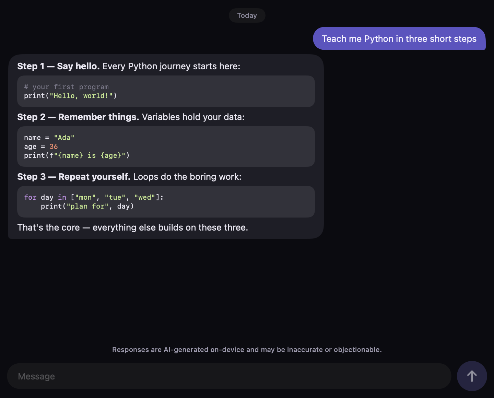

<p align="center">
  
</p>

<h1 align="center">Quenderin</h1>

<p align="center"><strong>AI on your device.</strong></p>
<p align="center">Run open models, keep conversations local, and choose what the assistant can do.</p>

<p align="center">
  <a href="https://apps.apple.com/app/id6789854363"><strong>Get the free Mac and iPhone apps</strong></a> ·
  <a href="https://quenderin.org/download.html">All downloads</a> ·
  <a href="https://quenderin.org">Website</a> ·
  <a href="docs/README.md">Documentation</a> ·
  <a href="LICENSE">MIT license</a>
</p>

Quenderin is an open-source assistant for running AI on hardware you own. Download
a model once, then use local chat offline: draft, study, work through code, or keep
personal notes without sending the conversation to an AI provider. No Quenderin
account, subscription, or API key is needed for local chat.

The project includes native **SwiftUI apps for macOS and iOS**, a native
**Kotlin / Jetpack Compose Android app**, and an **Electron desktop client and
TypeScript CLI**. They share model definitions, safety rules, and regression
fixtures, with automated checks to catch drift between implementations.

<p align="center">
  
</p>

## What you can do

- **Chat with a local model.** Streaming replies, Markdown and highlighted code,
  saved conversations, export, and model switching. Replies stay readable when
  you scroll back through a conversation during generation.
- **Choose a model that fits.** The library checks device memory and explains
  model fit. The task router suggests an installed model for coding or reasoning;
  you decide whether to switch. Catalog downloads are checked against pinned hashes.
- **Use the terminal.** Have an interactive conversation or pipe text into a
  single-answer command, using the same local model catalog.
- **Run governed tasks on a Mac through the CLI.** Grant a workspace folder,
  preview a task with `--dry-run`, approve changes, and review its local history.
  Reversible file tasks have an undo journal. App control through Accessibility
  is an explicit desktop option; the store mobile apps do not drive other apps.

The [capability guide](docs/ADDING_A_CAPABILITY.md) explains the agent's permission
tiers and testing seams. A [shared safety blocklist](shared/safety-blocklist.json)
blocks prohibited autonomous actions. Available tools and permissions differ by
platform; the [integration record](docs/bonsai-2.md) describes the current workflows
and their boundaries.

## New in the October source update

These workflows are **already integrated into `main`**, alongside a 28-entry text
catalog. They extend the project beyond ordinary text chat:

| Workflow | What is implemented |
|---|---|
| **More text models** | Pinned Prism runtime extensions and complete-artifact installers for Bonsai 2, Beam and Muse, plus adapters for additional October releases. Beam requires all 4 parts; Muse requires all 22. |
| **Ask about an image** | Separate still-image workflows for MiniCPM-V 4.7 and Nemotron 3.5 Super VL, with verified language-model/projector pairs and bounded JPEG/PNG input. |
| **Review proposed memories** | Hy-Memory proposes facts from a conversation you select. Every proposal starts unchecked; only facts you explicitly approve enter a separate private local store. |
| **Generate images locally** | Isolated FLUX 3 Image Klein and MOSS Image Base/SFT workflows, complete-component verification, and native import or desktop prepared-folder setup. Gated files require your own publisher access. |
| **Import Granite Switch 4.1 8B** | An offline converter and explicit chat workflow verify the complete official checkpoint, converted GGUF, and conversion receipt. |
| **Use your own CUDA host** | A separate Step 5 Preview text conversation connects to an existing host you configure, after explicit consent. Quenderin does not provision a server. |

**Integration is not inference validation or store availability.** Hosted builds,
package checks, and synthetic runtime fixtures have passed; full-weight inference,
image quality, peak memory, speed, and rendered native journeys for these additions
remain unverified. Hardware requirements vary substantially: some specialists
need workstation-class memory, and Step 5 runs on your separate GPU host.

Read the [October integration record](docs/bonsai-2.md) for exact artifacts,
licenses, memory floors, supported inputs, and reproduction commands. The
[release record](docs/RELEASE.md) ties builds and submissions to their source.

## Apps and availability

The repository moves ahead of the stores. The latest recorded release checks
are **19–20 October 2026**; follow the download links for current availability.

| Platform | Client | Distribution and recorded status |
|---|---|---|
| **macOS** | Native SwiftUI, shared `QuenderinKit` | Free [Mac App Store app](https://apps.apple.com/app/id6789854363). Version 0.5.0 (22) was submitted on 19 October; submission does not mean approval. |
| **iOS** | Native SwiftUI, shared `QuenderinKit` | Free [App Store app](https://apps.apple.com/app/id6789854363). Version 0.5.0 (22) was submitted on 19 October. |
| **Android** | Kotlin / Jetpack Compose | Existing Google Play closed Alpha. The 0.5.0 bundle is built and verified but unsigned for store distribution; its upload is blocked on the existing upload key. |
| **Windows / Linux** | Electron and TypeScript | [Preview downloads](https://quenderin.org/download.html). Published installers have their own release history; they do not automatically include every change on `main`. |

The Electron macOS build is a development testbed; the public Mac product is the
native App Store app. See [release evidence](docs/RELEASE.md) and the
[desktop distribution strategy](docs/WINDOWS_LINUX_STRATEGY.md).

## Privacy and control

**Installed local models process your prompts on your device and can run offline.**
Quenderin does not send app analytics, telemetry, or crash reports to the project,
and has no app account or automatic cloud sync.

There are specific network uses: model downloads, optional Hugging Face catalog
search, and public release-metadata checks. These do not send local conversations.
The optional Step 5 workflow sends the prompt and history from its **separate
conversation** to your configured host only after you approve sending. That host's
operator controls its own logging and retention. User-enabled Apple system
backups can also include local app data.

See the [privacy policy](docs/legal/privacy-policy.md) for the complete boundaries.

## Build and try the CLI

Requires **Node.js 20+ and npm 9+**. Model downloads are separate from installing
the source; choose one that fits your available memory and storage.

```bash
git clone https://github.com/alikatgh/quenderin.git
cd quenderin
npm ci
npm run build
npm link

quenderin models
quenderin download llama32-1b
quenderin chat
git diff | quenderin chat -p "Review this change"
```

On macOS, inspect capabilities and preview a workspace task:

```bash
quenderin capabilities
quenderin do "organize this folder" --workspace ~/Downloads --dry-run
quenderin history
```

After an actual reversible task, `quenderin undo` reverses the last recorded task.
A dry run makes no changes and does not replace an earlier task's undo journal.

For the desktop interface, run `npm run dashboard` or `npm run electron:dev`
after building. Experimental models require their pinned runtimes and complete
artifacts; a standard install is not sufficient for every specialist workflow.
Follow [the integration guide](docs/bonsai-2.md) for those prerequisites.

For native development, start with [the release/build record](docs/RELEASE.md),
which documents the pinned Prism build, existing Xcode Cloud workflow, Android
packaging, and signed-export checks. Apple project generation lives in
`apple/QuenderinApp/project.yml`; Android's Gradle project lives in `android/`.
A mock engine build is not evidence of model inference.

## Engineering you can inspect

- **Runtime work, beyond a catalog entry.** Pinned source patches, native bridges,
  publisher prompt adapters, and artifact manifests are versioned together. See
  [runtime provenance](shared/prism-runtime.json) and the
  [complete Muse manifest](shared/muse-spark-artifacts.json).
- **Resource ownership.** Ordinary text and specialist workflows use an exclusive
  memory lease. Cancellation and shutdown join active native work before releasing
  shared resources. Full-model size, available memory, and complete component sets
  gate loading; active-parameter counts do not stand in for memory requirements.
- **Cross-platform contracts.** Canonical catalogs and fixtures check the Swift,
  Kotlin, and TypeScript implementations. The
  [CI workflow](.github/workflows/ci.yml) includes native compilation, runtime
  fixtures, packaged desktop checks, Android library checks, and parity gates.
- **Published evidence and limitations.** All 18 engineering CI jobs passed for
  [release source `53994b7`](https://github.com/alikatgh/quenderin/actions/runs/39201633327).
  The [release record](docs/RELEASE.md) distinguishes that result from signed Apple
  exports, pending reviews, and the unsigned Android candidate.

Run the focused source checks without downloading model weights:

```bash
python3 scripts/check_catalog_parity.py
python3 scripts/check_agent_parity.py
python3 scripts/check_router_parity.py
python3 scripts/check_sampling_parity.py
python3 scripts/check_safety_parity.py
python3 scripts/generate_website_catalog.py --check
```

## Contribute

Useful contributions include reproducible device results, model/runtime
compatibility fixes, accessibility, translations, and regression tests. Report
the model, quantization, hardware, build, and reproduction steps with an issue.
Label measurements as physical-device, simulator, or host results.

Read [CONTRIBUTING.md](CONTRIBUTING.md), the [architecture](docs/ARCHITECTURE.md),
and the [documentation map](docs/README.md). The
[known failure modes](docs/KNOWN_FAILURE_MODES.md), [bug journal](docs/BUG_JOURNAL.md),
and [on-device research](docs/research/on-device-llm.md) document limitations and
prior investigations. For security reports, use [SECURITY.md](SECURITY.md).

## License

Quenderin's code is [MIT-licensed](LICENSE). Model weights, runtimes, and other
third-party components retain their own licenses; check the relevant manifest and
publisher terms. The elf artwork and Quenderin name identify this project;
please do not present derived works as official Quenderin releases.
